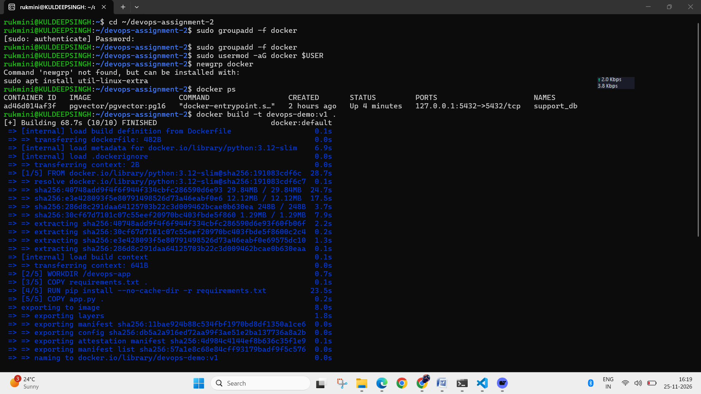

# Assignment 2 - Dockerized Flask Application with CI

## Objective

The objective of this assignment is to understand application containerization using Docker, deploy a Flask application inside a container and automate the Docker image build process using GitHub Actions.

## Tools and Technologies

- Ubuntu (WSL 2)
- Python
- Flask
- Docker
- Docker Desktop
- Visual Studio Code
- Git and GitHub
- GitHub Actions

## Project Structure

```text
devops-assignment-2/
├── .github/
│   └── workflows/
│       └── build.yml
├── screenshots/
│   ├── docker-build.png
│   └── container-health-check.png
├── app.py
├── requirements.txt
├── Dockerfile
└── README.md
```

## 1. Flask Application

The provided Flask application was used as the base application for understanding containerization.

The application exposes the following endpoints:

| Endpoint | Purpose |
|---|---|
| `/` | Displays the welcome message |
| `/health` | Checks whether the application is running |
| `/info` | Displays application and runtime environment information |

### Additional Feature - Application Information Endpoint

I added an additional `/info` endpoint to understand the environment in which the containerized application executes.

This endpoint provides:

- Application name
- Application version
- Container hostname
- Operating system
- Python version

The Python `socket` and `platform` modules are used to retrieve runtime environment information.

## 2. Docker Configuration

A Dockerfile was created to package the Flask application along with its dependencies into a Docker image.

### Dockerfile

```dockerfile
FROM python:3.12-slim

LABEL description="Flask application for learning Docker and CI"

WORKDIR /devops-app

COPY requirements.txt .

RUN pip install --no-cache-dir -r requirements.txt

COPY app.py .

EXPOSE 5000

CMD ["python", "app.py"]
```

### Docker Instructions Used

| Instruction | Purpose |
|---|---|
| FROM | Specifies the base Python image |
| LABEL | Adds descriptive metadata to the image |
| WORKDIR | Sets the working directory inside the container |
| COPY | Copies application files into the image |
| RUN | Installs application dependencies |
| EXPOSE | Documents the application port |
| CMD | Specifies the command to start the application |

The lightweight Python slim image was selected to avoid including unnecessary packages.

The requirements file is copied before the application code to allow Docker to reuse the dependency installation layer when application code changes.

## 3. Building and Running the Application

### Build the Docker Image

```bash
docker build -t devops-demo:v1 .
```

The image is named `devops-demo` and tagged with version `v1`.

### Verify the Docker Image

```bash
docker images
```

### Docker Build Output



### Run the Docker Container

```bash
docker run -d -p 127.0.0.1:5000:5000 --name devops-demo-container devops-demo:v1
```

| Option | Purpose |
|---|---|
| -d | Runs the container in the background |
| -p | Maps the host port to the container port |
| --name | Assigns a meaningful name to the container |
| devops-demo:v1 | Specifies the image used to create the container |

The application port is published on the host's localhost interface for local testing.

### Verify the Running Container

```bash
docker ps
```

## 4. Application Testing

The application endpoints were tested using the curl command.

### Home Endpoint

```bash
curl localhost:5000/
```

Output:

```text
Hello from DevOps!
```

### Health Check Endpoint

```bash
curl localhost:5000/health
```

Output:

```json
{"status":"ok"}
```

The successful response confirms that the application is accessible through the published Docker container port.

### Application Information Endpoint

```bash
curl localhost:5000/info
```

This endpoint returns application metadata, container hostname, operating system and Python version in JSON format.

The hostname may differ when a new container is created.

### Container and Endpoint Verification Output


## 5. Continuous Integration Using GitHub Actions

A GitHub Actions workflow was created to automatically build the Docker image whenever changes are pushed to the repository.

The workflow is located at:

```text
.github/workflows/build.yml
```

### Workflow Configuration

```yaml
name: DevOps Docker Build Check

on: [push]

jobs:
  docker-build:
    runs-on: ubuntu-latest

    steps:
      - name: Get application source code
        uses: actions/checkout@v4

      - name: Build application Docker image
        run: docker build -t devops-demo:v1 .

      - name: Verify generated Docker image
        run: docker images devops-demo:v1

      - name: Display build completion message
        run: echo "Application image built successfully!"
```

### Workflow Execution Process

1. A change is pushed to the GitHub repository.
2. GitHub Actions starts an Ubuntu runner.
3. The application source code is retrieved.
4. The Docker image is built.
5. The generated Docker image is listed for verification.
6. A completion message is displayed if the previous steps succeed.

This workflow helps identify Docker build errors automatically without requiring manual builds after every code change.

Pushing the Docker image to an external container registry is not required for this assignment.

### CI Workflow Verification

The workflow will be verified through the GitHub Actions tab after pushing the project to GitHub.

## 6. Problems Encountered During Implementation

### Docker Permission Denied Error

Initially, while accessing Docker from Ubuntu, I encountered a permission denied error related to the Docker daemon socket.

### Reason

The current Linux user did not have the required permissions to access the Docker daemon.

### Solution

The following commands were used:

```bash
sudo groupadd -f docker
sudo usermod -aG docker $USER
newgrp docker
```

The Docker connection was verified using:

```bash
docker ps
```

After updating the user permissions, Docker commands executed successfully.

### Dockerfile Naming Issue

Initially, the Dockerfile was created using a lowercase filename.

The file was renamed to `Dockerfile` to follow Docker's default naming convention.

## 7. Bug Identification and Fixes

The assignment mentions a teammate's application that cannot be accessed. However, the corresponding buggy code snippet was not included in the provided PDF.

Therefore, I identified common configuration problems that could prevent a Dockerized Flask application from running or being accessed.

| Problem | Reason | Fix |
|---|---|---|
| Flask binds to 127.0.0.1 inside the container | The application only accepts connections through the container's loopback interface | Configure Flask to bind to 0.0.0.0 |
| Missing port mapping | The application port is not published to the host | Use the appropriate `-p` option when running the container |
| Missing Flask dependency | The application cannot import Flask | Install dependencies using requirements.txt |
| Incorrect startup command | Docker attempts to execute an incorrect application file | Use `CMD ["python", "app.py"]` |

These are illustrative configuration problems and their corresponding fixes, rather than bugs identified in the missing code snippet.

## 8. Container Management

### Stop the Container

```bash
docker stop devops-demo-container
```

### Start a Stopped Container

```bash
docker start devops-demo-container
```

### View Container Logs

```bash
docker logs devops-demo-container
```

### Remove the Container

```bash
docker rm -f devops-demo-container
```

## 9. Key Learnings

Through this assignment, I learned:

- The difference between Docker images and containers.
- How to write and understand a Dockerfile.
- How to package an application with its dependencies.
- How to build and run Docker containers.
- How port mapping works.
- How to test application endpoints using curl.
- How to retrieve container runtime information.
- How to troubleshoot Docker permission issues.
- How to configure GitHub Actions for continuous integration.
- How automated builds help identify configuration errors.

## Conclusion

This assignment provided hands-on experience with Docker containerization and continuous integration. It helped me understand how applications can be packaged into consistent execution environments and how GitHub Actions can automate the build verification process whenever code changes are pushed to a repository.