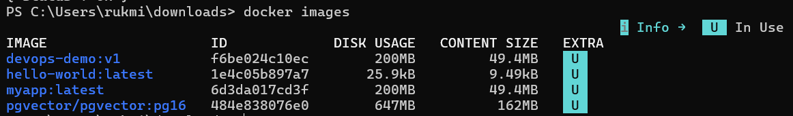
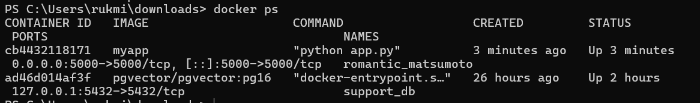
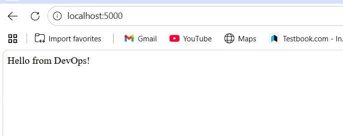

# Assignment 2 - Dockerized Flask Application with CI

## Objective

The objective of this assignment is to understand application containerization using Docker, run a Flask application inside a container and automate application build and health verification using GitHub Actions.

The primary focus is on understanding containers, dependency management, port mapping and automated CI checks rather than application development.

## Tools and Technologies

- Ubuntu (WSL 2)
- Python
- Flask
- Docker
- Docker Desktop
- Visual Studio Code
- Git and GitHub
- GitHub Actions

## Project Structure

```text
devops-assignment-2/
├── .github/
│   └── workflows/
│       └── build.yml
├── screenshots/
│   ├── ci-build-steps.png
│   ├── ci-success.png
│   ├── docker_image.png
│   ├── docker-image_creation.png
│   ├── health_endpoint.png
│   ├── home-endpoint.png
│   ├── info-endpoint.png
│   ├── running_container_info.png
│   ├── running_container_with_port.png
│   └── running_container_without_port.png
├── .dockerignore
├── app.py
├── Dockerfile
├── README.md
└── requirements.txt
```

## Getting Started

### Prerequisites

- Git
- Docker installed and running
- Terminal with access to Docker commands

### Clone the Repository

```bash
git clone https://github.com/Rukmini2309/DevOps_Assignment_2.git
cd DevOps_Assignment_2
```

## 1. Flask Application

The provided Flask application was used as the base application for understanding containerization.

The application exposes the following endpoints:

| Endpoint | Purpose |
|---|---|
| `/` | Displays the welcome message |
| `/health` | Checks whether the application is running |
| `/info` | Displays application and runtime environment information |

### Application Dependencies

The `requirements.txt` file contains the dependency required to run the application.

```text
flask
```

Docker installs this dependency while building the image, eliminating the need to manually install Flask on the host system.

### Additional Feature - Application Information Endpoint

An optional `/info` endpoint was added to understand the environment in which the containerized application executes.

This endpoint provides:

- Application name
- Application version
- Container hostname
- Operating system
- Python version

The Python `socket` and `platform` modules are used to retrieve runtime environment information.

## 2. Docker Configuration

A Dockerfile was created to package the Flask application along with its dependencies into a Docker image.

### Understanding Docker Images and Containers

A Docker image is a packaged template containing the application, its dependencies and the required runtime environment.

A Docker container is an instance of a Docker image that provides an isolated environment for executing the application.

```text
Application + Dependencies + Dockerfile
                  |
                  v
             Docker Image
                  |
                  v
            Docker Container
                  |
                  v
           Running Application
```

### Dockerfile

```dockerfile
FROM python:3.12-slim

LABEL description="Flask application for learning Docker and CI"

WORKDIR /devops-app

COPY requirements.txt .

RUN pip install --no-cache-dir -r requirements.txt

COPY app.py .

EXPOSE 5000

CMD ["python", "app.py"]
```

### Docker Instructions Used

| Instruction | Purpose |
|---|---|
| FROM | Specifies the base Python image |
| LABEL | Adds descriptive metadata to the image |
| WORKDIR | Sets the working directory inside the container |
| COPY | Copies application files into the image |
| RUN | Installs application dependencies |
| EXPOSE | Documents the application port |
| CMD | Specifies the command to start the application |

### Dockerfile Design Decisions

- The lightweight Python slim image was selected to avoid including unnecessary packages.
- The requirements file is copied before the application code to allow Docker to reuse the dependency installation layer when application code changes.
- The `--no-cache-dir` option prevents pip from storing unnecessary package download cache inside the image.
- Only the required application files are copied into the image.

## 3. Building and Running the Application

### Step 1: Build the Docker Image

```bash
docker build -t devops-demo:v1 .
```

| Option | Purpose |
|---|---|
| docker build | Builds an image using the Dockerfile |
| -t | Assigns a name and tag to the image |
| devops-demo:v1 | Image name and version tag |
| . | Uses the current directory as the build context |

### Docker Image Creation Output


### Step 2: Verify the Docker Image

```bash
docker images
```

This command lists the locally available Docker images, including the newly created `devops-demo:v1` image.

### Docker Image Verification Output



### Step 3: Running a Container Without Port Mapping

A Docker container can be started without publishing its application port.

Example:

```bash
docker run -d --name demo-without-port devops-demo:v1
```

Verify the running container:

```bash
docker ps
```

### Container Without Port Mapping


Although the Flask application runs inside the container, its application port is not published to the host system.

Therefore, the application cannot be accessed through the host's localhost port 5000 using this container alone.

The `EXPOSE 5000` instruction documents the application port but does not publish it automatically.

The demonstration container can be removed using:

```bash
docker rm -f demo-without-port
```

### Step 4: Running a Container With Port Mapping

```bash
docker run -d -p 127.0.0.1:5000:5000 --name devops-demo-container devops-demo:v1
```

| Option | Purpose |
|---|---|
| docker run | Creates and starts a container from an image |
| -d | Runs the container in the background |
| -p | Publishes the container port on the host |
| --name | Assigns a meaningful name to the container |
| devops-demo:v1 | Specifies the image used to create the container |

### Container With Port Mapping


### Understanding Port Mapping

The Flask application runs on port 5000 inside the container.

Port mapping makes the application accessible through port 5000 on the host system.

```text
Host System
127.0.0.1:5000
       |
       | Port Mapping
       v
Docker Container
Flask Application:5000
```

In the mapping `127.0.0.1:5000:5000`:

- `127.0.0.1` represents the host's localhost interface.
- The first `5000` represents the host port.
- The second `5000` represents the container port.

### Comparison of Containers With and Without Port Mapping

| Without Port Mapping | With Port Mapping |
|---|---|
| Application runs inside the container | Application runs inside the container |
| No application port is published | Application port is published |
| Application is not accessible through the host's localhost port | Application is accessible through localhost:5000 |
| Suitable when host access is not required | Suitable for local application testing |

### Step 5: Verify the Running Container

```bash
docker ps
```

This command displays the currently running containers, including their container ID, image, status, port mapping and container name.

### Running Container Information



## 4. Application Testing

The application endpoints were tested using the curl command to verify that the containerized application was accessible from the host system.

### Home Endpoint

```bash
curl localhost:5000/
```

Output:

```text
Hello from DevOps!
```

### Home Endpoint Execution Output



The response confirms that the application is running and accepting requests.

### Health Check Endpoint

```bash
curl localhost:5000/health
```

Output:

```json
{"status":"ok"}
```

### Health Check Execution Output


The successful response confirms that the application is accessible through the published Docker container port.

The health endpoint provides a simple mechanism for checking application availability.

### Application Information Endpoint

```bash
curl localhost:5000/info
```

This endpoint returns application metadata, container hostname, operating system and Python version in JSON format.

### Application Information Output


The output demonstrates that the application executes in a Linux-based container environment with its own hostname and Python runtime.

The hostname may differ when a new container is created.

### Application Testing Summary

| Endpoint | Verification | Result |
|---|---|---|
| `/` | Welcome message | Passed |
| `/health` | Application availability | Passed |
| `/info` | Runtime environment information | Passed |

## 5. Continuous Integration Using GitHub Actions

Continuous Integration (CI) is a development practice in which automated checks are executed whenever changes are integrated into a repository.

A GitHub Actions workflow was created to automatically build the Docker image whenever changes are pushed to the repository.

The workflow was further extended to run the container and test the application health endpoint automatically.

### Workflow Location

```text
.github/workflows/build.yml
```

### Updated Workflow Configuration

```yaml
name: DevOps Docker Build Check

on: [push]

jobs:
  docker-build:
    runs-on: ubuntu-latest

    steps:
      - name: Get application source code
        uses: actions/checkout@v4

      - name: Build application Docker image
        run: docker build -t devops-demo:v1 .

      - name: Verify generated Docker image
        run: docker images devops-demo:v1

      - name: Run application container
        run: docker run -d -p 127.0.0.1:5000:5000 --name ci-test-container devops-demo:v1

      - name: Test health endpoint
        run: curl --fail --retry 5 --retry-connrefused --retry-delay 2 http://localhost:5000/health

      - name: Display build completion message
        run: echo "Application image built and health check passed successfully!"

      - name: Remove test container
        if: always()
        run: docker rm -f ci-test-container
```

### Workflow Components

| Component | Purpose |
|---|---|
| name | Defines the workflow name |
| on: [push] | Triggers the workflow whenever changes are pushed |
| jobs | Defines the tasks performed by the workflow |
| docker-build | Name of the build job |
| runs-on | Specifies the runner environment |
| steps | Defines individual operations |
| actions/checkout@v4 | Retrieves the repository source code |
| run | Executes shell commands on the runner |
| if: always() | Executes the cleanup step regardless of the workflow result |

### Workflow Execution Process

```text
Developer pushes changes to GitHub
                |
                v
GitHub Actions triggers the workflow
                |
                v
Ubuntu runner is initialized
                |
                v
Application source code is retrieved
                |
                v
Docker image is built
                |
                v
Generated Docker image is listed
                |
                v
Application container is started
                |
                v
Health endpoint is tested
                |
                v
Build and test status is reported
                |
                v
Test container is removed
```

### Initial CI Workflow Verification

The initial build-only CI workflow was automatically triggered after pushing the project to GitHub and completed successfully.

| Parameter | Result |
|---|---|
| Workflow Name | DevOps Docker Build Check |
| Workflow Run | #1 |
| Trigger | Git Push |
| Branch | main |
| Build Status | Passed |
| Total Workflow Duration | 26 seconds |
| Docker Build Job Duration | 21 seconds |

### Successful Initial CI Workflow


### Individual CI Build Steps


All configured steps of the initial workflow completed successfully.

| Workflow Step | Status |
|---|---|
| Get application source code | Passed |
| Build application Docker image | Passed |
| Verify generated Docker image | Passed |
| Display build completion message | Passed |

The initial workflow reported one warning, which did not prevent successful completion.

### Enhanced CI Workflow Verification

The workflow was extended to include automated container execution and health endpoint verification.

Verification of the enhanced workflow is pending.

<!-- Add enhanced CI screenshots after successful execution.


-->

### How CI Detects Build and Test Failures

GitHub Actions monitors the exit status of the commands executed during the workflow.

- An exit status of zero indicates successful command execution.
- A non-zero exit status indicates command failure.
- If the Docker build command fails, the corresponding CI step fails.
- If the health endpoint cannot be reached or returns an HTTP error, the health check step fails.
- Subsequent normal steps are skipped by default when an earlier step fails.
- The cleanup step is configured to run regardless of success or failure.

```text
        Docker Build
              |
              v
       Build Successful?
         /          \
       Yes           No
        |             |
        v             v
   Run Container   CI Failed
        |
        v
   Test Health Endpoint
        |
        v
    Check Passed?
      /       \
    Yes        No
     |          |
     v          v
 CI Passed   CI Failed
```

### Benefits of Automated CI Checks

- Automatically verifies Docker image creation after every push.
- Identifies Dockerfile and dependency installation errors.
- Checks whether the containerized application can start.
- Automatically verifies application availability.
- Provides feedback about build and test failures.
- Reduces repetitive manual verification.
- Verifies the application in a separate runner environment.

Pushing the Docker image to an external container registry is not required for this assignment.

## 6. Problems Encountered During Implementation

### Docker Permission Denied Error

Initially, while accessing Docker from Ubuntu, I encountered a permission denied error related to the Docker daemon socket.

### Reason

The current Linux user did not have the required permissions to access the Docker daemon.

### Solution

The following commands were used:

```bash
sudo groupadd -f docker
sudo usermod -aG docker $USER
newgrp docker
```

| Command | Purpose |
|---|---|
| groupadd -f docker | Ensures that the Docker group exists |
| usermod -aG docker $USER | Adds the current user to the Docker group |
| newgrp docker | Activates the updated group membership in a new shell |

The Docker connection was verified using:

```bash
docker ps
```

After updating the user permissions, Docker commands executed successfully.

Membership in the Docker group provides powerful access to the Docker daemon and should only be granted to trusted users.

### Dockerfile Naming Issue

Initially, the Dockerfile was created using a lowercase filename.

Docker expects a file named `Dockerfile` by default when executing the build command.

The file was renamed to `Dockerfile` to follow Docker's default naming convention.

## 7. Bug Identification and Fixes

The assignment provides a buggy Dockerfile and Docker run command written by a teammate whose application cannot be accessed.

### Provided Buggy Dockerfile

```dockerfile
FORM python:3.12-slim

WORKDIR /app

COPY . .

RUN pip install -r requirement.txt

CMD ["python", "app.py"]
```

### Provided Docker Run Command

```bash
docker run -p 5000:8080 myapp
```

Three actual bugs were identified in the provided configuration.

### Bug 1: Incorrect Dockerfile Instruction

Incorrect:

```dockerfile
FORM python:3.12-slim
```

Reason:

`FORM` is not a valid Dockerfile instruction. Docker cannot interpret this instruction, causing the image build to fail.

Fix:

```dockerfile
FROM python:3.12-slim
```

The `FROM` instruction specifies the base image used to build the application image.

### Bug 2: Incorrect Requirements Filename

Incorrect:

```dockerfile
RUN pip install -r requirement.txt
```

Reason:

The provided dependency file is named `requirements.txt`, not `requirement.txt`.

The incorrect filename prevents pip from locating the dependency file, causing the image build to fail.

Fix:

```dockerfile
RUN pip install -r requirements.txt
```

This installs the dependencies from the correct file.

### Bug 3: Incorrect Container Port Mapping

Incorrect:

```bash
docker run -p 5000:8080 myapp
```

Reason:

The Flask application listens on port 5000 inside the container.

However, the provided command forwards requests from host port 5000 to container port 8080, where the Flask application is not listening.

Fix:

```bash
docker run -p 5000:5000 myapp
```

The corrected command maps host port 5000 to container port 5000.

### Bug Identification Summary

| Bug | Impact | Fix |
|---|---|---|
| FORM instead of FROM | Dockerfile parsing fails | Use FROM |
| requirement.txt instead of requirements.txt | Dependency installation fails | Use the correct filename |
| Host port 5000 mapped to container port 8080 | Application cannot be reached | Map host port 5000 to container port 5000 |

### Corrected Version of the Provided Dockerfile

```dockerfile
FROM python:3.12-slim

WORKDIR /app

COPY . .

RUN pip install -r requirements.txt

CMD ["python", "app.py"]
```

### Corrected Build and Run Commands

```bash
docker build -t myapp .
docker run -p 5000:5000 myapp
```

### Verify the Corrected Application

From another terminal:

```bash
curl localhost:5000/health
```

Expected output:

```json
{"status":"ok"}
```

These commands demonstrate the direct correction of the teammate's configuration.

The Dockerfile and run command used in this project already incorporate the three required corrections.

### Additional Observations

- `COPY . .` is valid but may copy unnecessary files into the image.
- Copying requirements.txt separately improves Docker layer caching.
- Adding `EXPOSE 5000` improves documentation but is not required for port publishing.
- The original `CMD ["python", "app.py"]` instruction is correct.
- The provided Flask application already binds to `0.0.0.0`, which is appropriate for container networking.

These observations are additional improvements rather than bugs in the provided configuration.

## 8. Bonus Features

### Bonus 1: Using .dockerignore

A `.dockerignore` file was created in the project root directory to exclude unnecessary files from the Docker build context.

### .dockerignore Configuration

```dockerignore
.git
.github/
screenshots/
README.md
__pycache__/
*.pyc
.venv/
venv/
.env
```

### Excluded Files and Their Purpose

| File or Directory | Reason for Exclusion |
|---|---|
| .git | Git repository metadata is not required for building the application |
| .github/ | GitHub Actions configuration is not required inside the image |
| screenshots/ | Documentation images are not required by the application |
| README.md | Project documentation is not required for application execution |
| __pycache__/ | Excludes Python cache directories |
| *.pyc | Excludes compiled Python bytecode files |
| .venv/ and venv/ | Excludes local Python virtual environments |
| .env | Excludes potentially sensitive environment variables |

### Benefits of .dockerignore

- Reduces unnecessary Docker build context size.
- Prevents irrelevant files from being sent to the Docker builder.
- Helps keep the build context clean.
- Prevents the local `.env` file from being included in the build context.
- Makes the configuration more maintainable.

### Verification

After creating the `.dockerignore` file, the Docker image was rebuilt using:

```bash
docker build -t devops-demo:v1 .
```

The image was built successfully, confirming that the required application files remained available in the build context.

### Bonus 2: Automated Health Check in CI

The GitHub Actions workflow was extended to automatically run the Docker container and test the health endpoint.

### Run Application Container

```yaml
- name: Run application container
  run: docker run -d -p 127.0.0.1:5000:5000 --name ci-test-container devops-demo:v1
```

This step starts the application container inside the GitHub Actions runner.

### Test Health Endpoint

```yaml
- name: Test health endpoint
  run: curl --fail --retry 5 --retry-connrefused --retry-delay 2 http://localhost:5000/health
```

### Curl Options Used

| Option | Purpose |
|---|---|
| --fail | Returns a non-zero exit status for HTTP error responses |
| --retry 5 | Allows up to five retries for eligible failures |
| --retry-connrefused | Retries when the application is not yet accepting connections |
| --retry-delay 2 | Waits two seconds between retries |

The retry mechanism allows time for the Flask application to initialize before the health check fails.

Expected output:

```json
{"status":"ok"}
```

### Container Cleanup

```yaml
- name: Remove test container
  if: always()
  run: docker rm -f ci-test-container
```

The cleanup step removes the test container after verification.

The `if: always()` condition ensures that cleanup is attempted even if an earlier workflow step fails.

### Basic CI vs Enhanced CI

| Feature | Initial CI | Enhanced CI |
|---|---|---|
| Automatic Docker image build | Yes | Yes |
| Docker image verification | Yes | Yes |
| Automatic container execution | No | Yes |
| Automated health check | No | Yes |
| Container cleanup | No | Yes |
| Build failure detection | Yes | Yes |
| Application availability verification | No | Yes |

The enhanced workflow verifies both Docker image creation and application availability.

## 9. Container Management

The following Docker commands can be used to manage the application container.

### Stop the Container

```bash
docker stop devops-demo-container
```

Stops the running container without deleting it.

### Start a Stopped Container

```bash
docker start devops-demo-container
```

Starts an existing stopped container.

### View Container Logs

```bash
docker logs devops-demo-container
```

Displays application logs and helps identify runtime errors.

### List All Containers

```bash
docker ps -a
```

Displays both running and stopped containers.

### Remove the Container

```bash
docker rm -f devops-demo-container
```

Stops and removes the container.

The Docker image remains available for creating new containers.

## 10. Assignment Verification

### Mandatory Requirements

| Requirement | Status |
|---|---|
| Use the provided Flask application | Completed |
| Create requirements.txt | Completed |
| Create a Dockerfile | Completed |
| Build the Docker image | Completed |
| Run the Docker container | Completed |
| Verify the health endpoint using curl | Completed |
| Create GitHub Actions workflow | Completed |
| Automatically build the Docker image on every push | Completed |
| Verify successful initial CI execution | Completed |
| Identify the three actual bugs | Completed |
| Explain the corresponding fixes | Completed |
| Document commands and sample outputs | Completed |

### Bonus Requirements

| Requirement | Status |
|---|---|
| Use .dockerignore | Completed and verified |
| Automated health check in CI | Configured; execution verification pending |
| Run container as a non-root user | Not implemented - optional |

## 11. Key Learnings

Through this assignment, I learned:

- The difference between Docker images and containers.
- How containers provide isolated application environments.
- How to write and understand a Dockerfile.
- How to package an application with its dependencies.
- How Docker image layers and build caching work.
- How to build and run Docker containers.
- The difference between exposed and published ports.
- How port mapping affects application accessibility.
- How to test application endpoints using curl.
- How to retrieve container runtime information.
- How to troubleshoot Docker permission issues.
- How to identify and fix Dockerfile syntax and configuration errors.
- How to use .dockerignore to exclude unnecessary files.
- How to manage running and stopped containers.
- How to configure GitHub Actions for continuous integration.
- How CI detects build success and failure.
- How automated health checks can verify application availability.

## Conclusion

This assignment provided hands-on experience with Docker containerization and continuous integration.

It helped me understand how applications can be packaged with their dependencies and executed in consistent, isolated environments.

The successful execution of the initial GitHub Actions workflow demonstrated how CI can automate Docker build verification whenever changes are pushed to a repository.

The additional .dockerignore configuration and automated health check extend the project beyond basic image creation by improving build context management and introducing application runtime verification.

The assignment demonstrates the practical use of Docker and GitHub Actions for building, running, testing and maintaining containerized applications.
