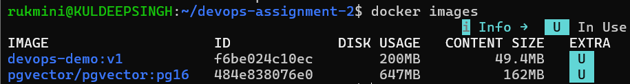
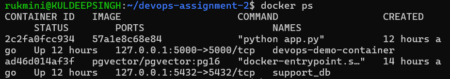
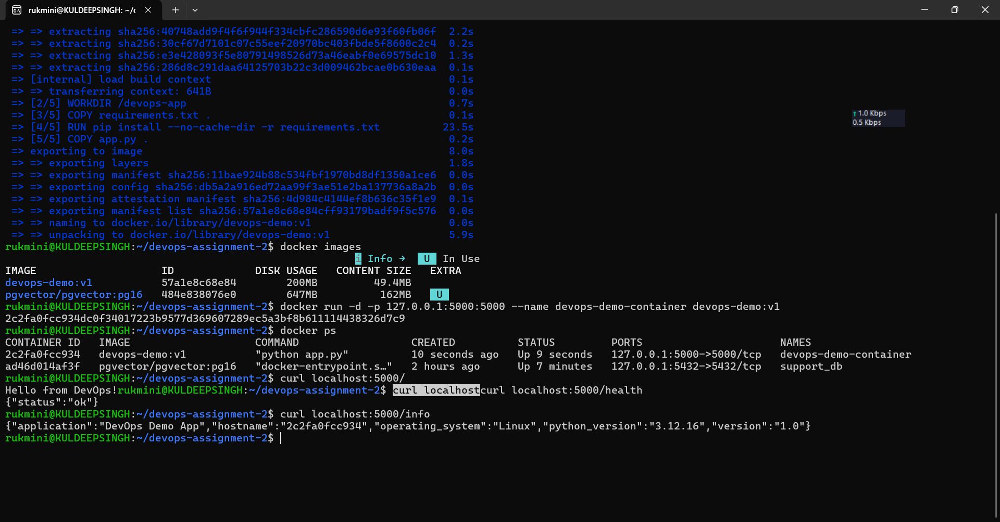
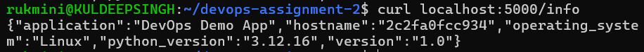
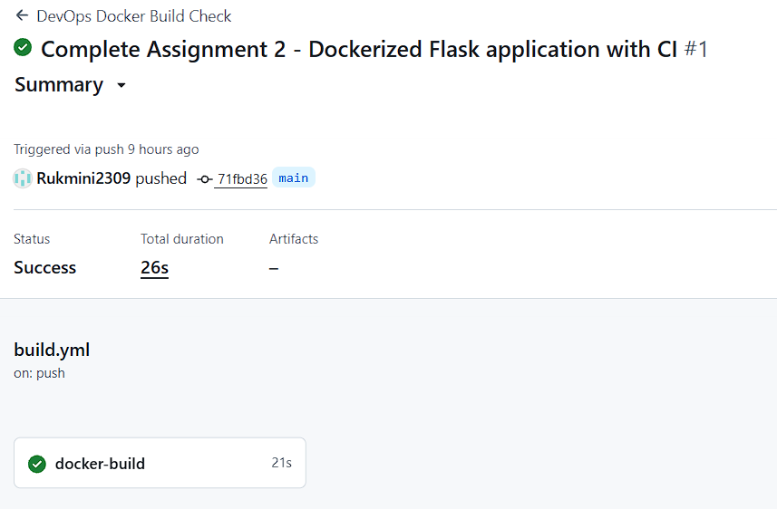

# Assignment 2 - Dockerized Flask Application with CI

## Objective

The objective of this assignment is to understand application containerization using Docker, run a Flask application inside a container and automate the Docker image build process using GitHub Actions.

The primary focus is on understanding containers, dependency management, application verification and automated build checks rather than application development.

## Tools and Technologies

- Ubuntu (WSL 2)
- Python
- Flask
- Docker
- Docker Desktop
- Visual Studio Code
- Git and GitHub
- GitHub Actions

## Project Structure

```text
devops-assignment-2/
├── .github/
│   └── workflows/
│       └── build.yml
├── screenshots/
│   ├── ci-build-steps.png
│   ├── ci-success.png
│   ├── container-health-check.png
│   ├── container-running.png
│   ├── docker-build.png
│   ├── docker-image.png
│   ├── home-endpoint.png
│   └── info-endpoint.png
├── app.py
├── Dockerfile
├── README.md
└── requirements.txt
```

## Getting Started

### Prerequisites

- Git
- Docker installed and running
- Terminal with access to Docker commands

### Clone the Repository

```bash
git clone https://github.com/Rukmini2309/DevOps_Assignment_2.git
cd DevOps_Assignment_2
```

## 1. Flask Application

The provided Flask application was used as the base application for understanding containerization.

The application exposes the following endpoints:

| Endpoint | Purpose |
|---|---|
| `/` | Displays the welcome message |
| `/health` | Checks whether the application is running |
| `/info` | Displays application and runtime environment information |

### Application Dependencies

The `requirements.txt` file contains the dependency required to run the application.

```text
flask
```

Docker installs this dependency while building the image, eliminating the need to manually install Flask on the host system.

### Additional Feature - Application Information Endpoint

I added an optional `/info` endpoint to understand the environment in which the containerized application executes.

This endpoint provides:

- Application name
- Application version
- Container hostname
- Operating system
- Python version

The Python `socket` and `platform` modules are used to retrieve runtime environment information.

## 2. Docker Configuration

A Dockerfile was created to package the Flask application along with its dependencies into a Docker image.

### Understanding Docker Images and Containers

A Docker image is a packaged template containing the application, its dependencies and the required runtime environment.

A Docker container is a running instance of a Docker image that executes the application in an isolated environment.

```text
Application + Dependencies + Dockerfile
                  |
                  v
             Docker Image
                  |
                  v
            Docker Container
                  |
                  v
           Running Application
```

### Dockerfile

```dockerfile
FROM python:3.12-slim

LABEL description="Flask application for learning Docker and CI"

WORKDIR /devops-app

COPY requirements.txt .

RUN pip install --no-cache-dir -r requirements.txt

COPY app.py .

EXPOSE 5000

CMD ["python", "app.py"]
```

### Docker Instructions Used

| Instruction | Purpose |
|---|---|
| FROM | Specifies the base Python image |
| LABEL | Adds descriptive metadata to the image |
| WORKDIR | Sets the working directory inside the container |
| COPY | Copies application files into the image |
| RUN | Installs application dependencies |
| EXPOSE | Documents the application port |
| CMD | Specifies the command to start the application |

### Dockerfile Design Decisions

The lightweight Python slim image was selected to avoid including unnecessary packages.

The requirements file is copied before the application code to allow Docker to reuse the dependency installation layer when application code changes.

The `--no-cache-dir` option prevents pip from storing unnecessary package download cache inside the image.

## 3. Building and Running the Application

### Step 1: Build the Docker Image

```bash
docker build -t devops-demo:v1 .
```

| Option | Purpose |
|---|---|
| docker build | Builds an image using the Dockerfile |
| -t | Assigns a name and tag to the image |
| devops-demo:v1 | Image name and version tag |
| . | Uses the current directory as the build context |

### Docker Build Output


### Step 2: Verify the Docker Image

```bash
docker images
```

This command lists the locally available Docker images, including the newly created `devops-demo:v1` image.

### Docker Image Verification Output



### Step 3: Run the Docker Container

```bash
docker run -d -p 127.0.0.1:5000:5000 --name devops-demo-container devops-demo:v1
```

| Option | Purpose |
|---|---|
| docker run | Creates and starts a container from an image |
| -d | Runs the container in the background |
| -p | Maps the host port to the container port |
| --name | Assigns a meaningful name to the container |
| devops-demo:v1 | Specifies the image used to create the container |

### Understanding Port Mapping

The Flask application runs on port 5000 inside the container.

The port mapping makes the application accessible through port 5000 on the host system.

```text
Host System
127.0.0.1:5000
       |
       | Port Mapping
       v
Docker Container
Flask Application:5000
```

The application port is published on the host's localhost interface for local testing.

### Step 4: Verify the Running Container

```bash
docker ps
```

This command displays the currently running containers, including their container ID, image, status, port mapping and container name.

### Running Container Output



## 4. Application Testing

The application endpoints were tested using the curl command to verify that the containerized application was accessible from the host system.

### Home Endpoint

```bash
curl localhost:5000/
```

Expected output:

```text
Hello from DevOps!
```

### Home Endpoint Execution Output


The response confirms that the application is running and accepting requests.

### Health Check Endpoint

```bash
curl localhost:5000/health
```

Expected output:

```json
{"status":"ok"}
```

### Health Check Execution Output



The successful response confirms that the application is accessible through the published Docker container port.

The health endpoint provides a simple mechanism for checking application availability.

### Application Information Endpoint

```bash
curl localhost:5000/info
```

This endpoint returns application metadata, container hostname, operating system and Python version in JSON format.

### Application Information Output



The output demonstrates that the application is executing in a Linux-based container environment with its own hostname and Python runtime.

The hostname may differ when a new container is created.

### Application Testing Summary

| Endpoint | Verification | Result |
|---|---|---|
| `/` | Welcome message | Passed |
| `/health` | Application availability | Passed |
| `/info` | Runtime environment information | Passed |

## 5. Continuous Integration Using GitHub Actions

Continuous Integration (CI) is a development practice in which automated checks are executed whenever changes are integrated into a repository.

A GitHub Actions workflow was created to automatically build the Docker image whenever changes are pushed to the repository.

This eliminates the need to manually verify the Docker build after every change.

### Workflow Location

```text
.github/workflows/build.yml
```

### Workflow Configuration

```yaml
name: DevOps Docker Build Check

on: [push]

jobs:
  docker-build:
    runs-on: ubuntu-latest

    steps:
      - name: Get application source code
        uses: actions/checkout@v4

      - name: Build application Docker image
        run: docker build -t devops-demo:v1 .

      - name: Verify generated Docker image
        run: docker images devops-demo:v1

      - name: Display build completion message
        run: echo "Application image built successfully!"
```

### Workflow Components

| Component | Purpose |
|---|---|
| name | Defines the workflow name |
| on: [push] | Triggers the workflow whenever changes are pushed |
| jobs | Defines the tasks performed by the workflow |
| docker-build | Name of the build job |
| runs-on | Specifies the runner environment |
| steps | Defines individual operations |
| actions/checkout@v4 | Retrieves the repository source code |
| run | Executes a shell command on the runner |

### Workflow Execution Process

```text
Developer pushes changes to GitHub
                |
                v
GitHub Actions triggers the workflow
                |
                v
Ubuntu runner is initialized
                |
                v
Application source code is retrieved
                |
                v
Docker image is built
                |
                v
Generated image is listed
                |
                v
Build status is reported
```

### CI Workflow Verification

After pushing the project to GitHub, the CI workflow was automatically triggered and completed successfully.

### Build Results

| Parameter | Result |
|---|---|
| Workflow Name | DevOps Docker Build Check |
| Workflow Run | #1 |
| Trigger | Git Push |
| Branch | main |
| Build Status | Passed |
| Total Workflow Duration | 26 seconds |
| Docker Build Job Duration | 21 seconds |

### Successful CI Workflow Execution



The workflow summary confirms that the push event automatically triggered the CI pipeline and that the Docker build job completed successfully.

### Individual CI Build Steps


### Step-wise Verification

| Workflow Step | Status |
|---|---|
| Set up job | Passed |
| Get application source code | Passed |
| Build application Docker image | Passed |
| Verify generated Docker image | Passed |
| Display build completion message | Passed |
| Complete job | Passed |

All configured workflow steps completed successfully.

The workflow also reported one warning, which did not prevent successful completion.

### How CI Detects Build Failures

GitHub Actions monitors the exit status of the commands executed during the workflow.

- An exit status of zero indicates successful execution.
- A non-zero exit status indicates command failure.
- If the Docker build command fails, the workflow is marked as failed.
- Subsequent steps are skipped by default when an earlier step fails.
- Developers can inspect the workflow logs to identify the cause of the failure.

```text
        Docker Build
              |
              v
     Command Successful?
         /          \
       Yes           No
        |             |
        v             v
   Build Passed   Build Failed
```

### Benefits of Automated Build Checks

- Automatically verifies Docker image creation after every push.
- Identifies dependency installation and Dockerfile errors.
- Provides immediate feedback about build success or failure.
- Reduces repetitive manual build verification.
- Verifies the build in a separate runner environment.

The CI workflow verifies Docker image creation, while application runtime and health checks are performed separately using curl.

Pushing the Docker image to an external container registry is not required for this assignment.

## 6. Problems Encountered During Implementation

### Docker Permission Denied Error

Initially, while accessing Docker from Ubuntu, I encountered a permission denied error related to the Docker daemon socket.

### Reason

The current Linux user did not have the required permissions to access the Docker daemon.

### Solution

The following commands were used:

```bash
sudo groupadd -f docker
sudo usermod -aG docker $USER
newgrp docker
```

| Command | Purpose |
|---|---|
| groupadd -f docker | Ensures that the Docker group exists |
| usermod -aG docker $USER | Adds the current user to the Docker group |
| newgrp docker | Activates the updated group membership in a new shell |

The Docker connection was verified using:

```bash
docker ps
```

After updating the user permissions, Docker commands executed successfully.

### Dockerfile Naming Issue

Initially, the Dockerfile was created using a lowercase filename.

Docker expects a file named `Dockerfile` by default when executing the build command.

The file was renamed to `Dockerfile` to follow Docker's default naming convention.

## 7. Bug Identification and Fixes

The assignment mentions a teammate's application that cannot be accessed. However, the corresponding buggy code snippet was not included in the provided PDF.

Therefore, I identified common configuration problems that could prevent a Dockerized Flask application from running or being accessed.

### Common Problems and Solutions

| Problem | Reason | Fix |
|---|---|---|
| Flask binds to 127.0.0.1 inside the container | The application only accepts connections through the container's loopback interface | Configure Flask to bind to 0.0.0.0 |
| Missing port mapping | The application port is not published to the host | Use the appropriate `-p` option when running the container |
| Missing Flask dependency | The application cannot import Flask | Install dependencies using requirements.txt |
| Incorrect startup command | Docker attempts to execute an incorrect application file | Use `CMD ["python", "app.py"]` |

### Correct Flask Configuration

```python
app.run(host="0.0.0.0", port=5000)
```

Binding Flask to `0.0.0.0` allows it to accept connections through the container's network interfaces.

### Correct Port Mapping

```bash
docker run -d -p 127.0.0.1:5000:5000 --name devops-demo-container devops-demo:v1
```

### Correct Dependency Installation

```dockerfile
COPY requirements.txt .
RUN pip install --no-cache-dir -r requirements.txt
```

### Correct Application Startup Command

```dockerfile
CMD ["python", "app.py"]
```

These are illustrative configuration problems and their corresponding fixes, rather than bugs identified in the missing code snippet.

## 8. Container Management

The following Docker commands can be used to manage the application container.

### Stop the Container

```bash
docker stop devops-demo-container
```

Stops the running container without deleting it.

### Start a Stopped Container

```bash
docker start devops-demo-container
```

Restarts an existing stopped container.

### View Container Logs

```bash
docker logs devops-demo-container
```

Displays application logs and helps identify runtime errors.

### List All Containers

```bash
docker ps -a
```

Displays both running and stopped containers.

### Remove the Container

```bash
docker rm -f devops-demo-container
```

Stops and removes the container. The Docker image remains available for creating new containers.

## 9. Assignment Verification

| Requirement | Status |
|---|---|
| Use the provided Flask application | Completed |
| Create requirements.txt | Completed |
| Create a Dockerfile | Completed |
| Build the Docker image | Completed |
| Run the Docker container | Completed |
| Verify the health endpoint using curl | Completed |
| Create GitHub Actions workflow | Completed |
| Automatically build the image on push | Completed |
| Verify successful CI execution | Completed |
| Document commands and execution outputs | Completed |
| Identify and explain common configuration bugs | Documented with illustrative examples |

## 10. Key Learnings

Through this assignment, I learned:

- The difference between Docker images and containers.
- How containers provide isolated application environments.
- How to write and understand a Dockerfile.
- How to package an application with its dependencies.
- How Docker image layers and build caching work.
- How to build and run Docker containers.
- How port mapping works.
- How to test application endpoints using curl.
- How to retrieve container runtime information.
- How to troubleshoot Docker permission issues.
- How to manage running and stopped containers.
- How to configure GitHub Actions for continuous integration.
- How CI automatically detects build success and failure.
- How automated builds help identify configuration errors.

## Conclusion

This assignment provided hands-on experience with Docker containerization and continuous integration.

It helped me understand how applications can be packaged with their dependencies and executed in consistent, isolated environments.

The successful execution of the GitHub Actions workflow demonstrated how CI can automate Docker build verification whenever changes are pushed to a repository, reducing manual effort and providing feedback about build errors.
