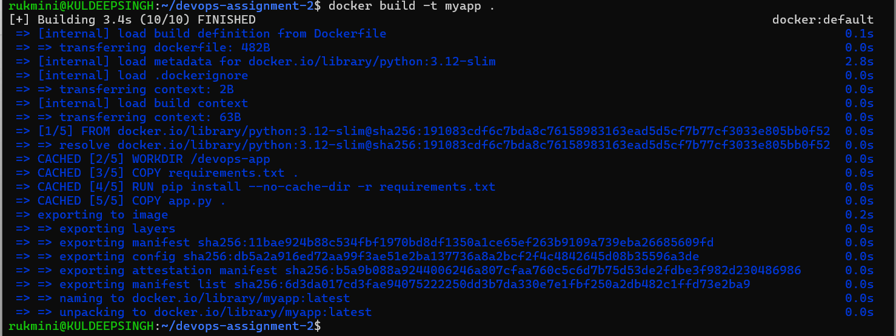
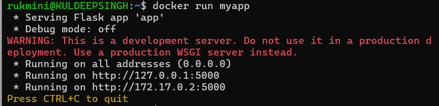
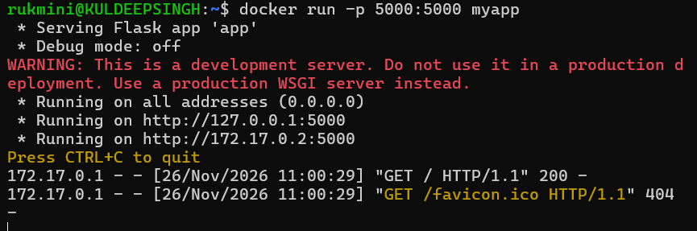
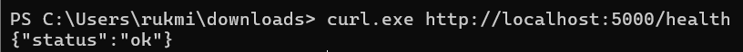
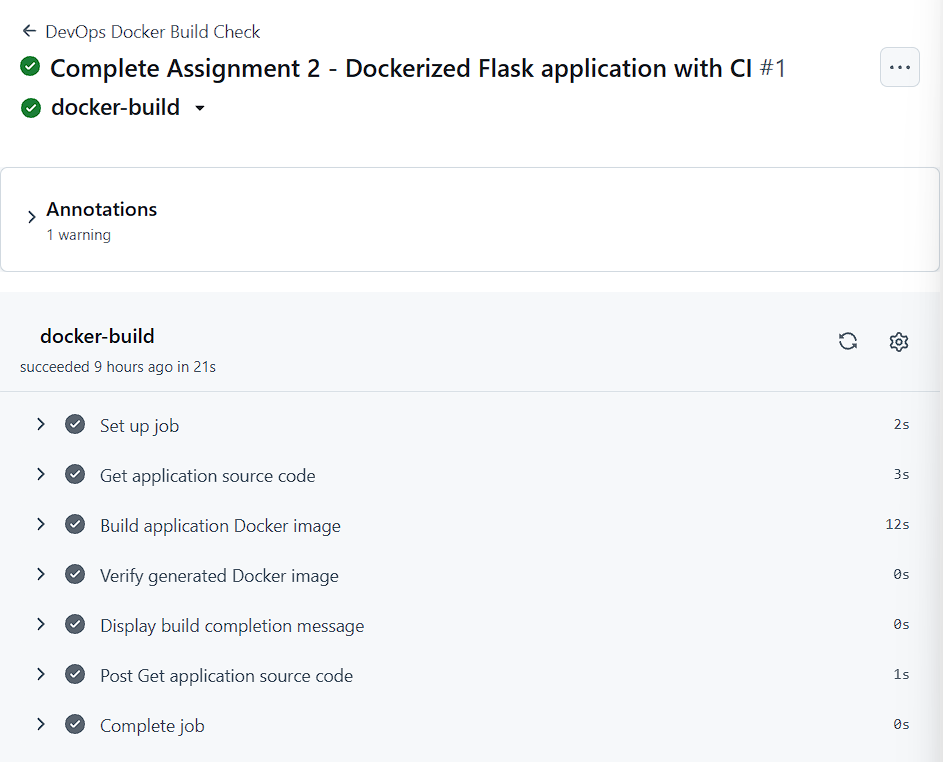

# Assignment 2 - Dockerized Flask Application with CI

## Objective

To containerize a Flask application using Docker, verify its functionality and automate Docker image builds using GitHub Actions.

## Tools and Technologies

- Ubuntu (WSL 2)
- Python and Flask
- Docker and Docker Desktop
- Visual Studio Code
- Git and GitHub
- GitHub Actions

## Project Structure

```text
devops-assignment-2/
├── .github/
│   └── workflows/
│       └── build.yml
├── screenshots/
│   ├── ci-build-steps.png
│   ├── ci-success.png
│   ├── docker_image.png
│   ├── docker-image_creation.png
│   ├── health_endpoint.png
│   ├── home-endpoint.png
│   ├── info-endpoint.png
│   ├── running_container_info.png
│   ├── running_container_with_port.png
│   └── running_container_without_port.png
├── .dockerignore
├── app.py
├── Dockerfile
├── README.md
└── requirements.txt
```

## Getting Started

### Prerequisites

- Git
- Docker installed and running

### Clone the Repository

```bash
git clone https://github.com/Rukmini2309/DevOps_Assignment_2.git
cd DevOps_Assignment_2
```

## 1. Flask Application

The provided Flask application was used with an additional `/info` endpoint.

| Endpoint | Purpose |
|---|---|
| `/` | Displays the welcome message |
| `/health` | Returns application health status |
| `/info` | Displays application and runtime information |

### Application Dependencies

The `requirements.txt` file contains:

```text
flask
```

### Additional Information Endpoint

The `/info` endpoint uses Python's `socket` and `platform` modules to display the application name, version, container hostname, operating system and Python version.

## 2. Docker Configuration

A Docker image contains the application, dependencies and runtime environment. A container is an executable instance of that image.

```text
Application + Dependencies + Dockerfile
                  |
                  v
             Docker Image
                  |
                  v
            Docker Container
```

### Dockerfile

```dockerfile
FROM python:3.12-slim

LABEL description="Flask application for learning Docker and CI"

WORKDIR /devops-app

COPY requirements.txt .

RUN pip install --no-cache-dir -r requirements.txt

COPY app.py .

EXPOSE 5000

CMD ["python", "app.py"]
```

### Dockerfile Instructions

| Instruction | Purpose |
|---|---|
| FROM | Specifies the base image |
| LABEL | Adds image metadata |
| WORKDIR | Sets the working directory |
| COPY | Copies required files |
| RUN | Installs dependencies |
| EXPOSE | Documents the application port |
| CMD | Starts the Flask application |

### Design Decisions

- Python slim image reduces unnecessary packages.
- Copying requirements.txt separately improves Docker layer caching.
- The `--no-cache-dir` option avoids storing unnecessary pip cache files.

## 3. Building and Running the Application

### Step 1: Build the Docker Image

```bash
docker build -t devops-demo:v1 .
```

The `-t` option assigns a name and version tag to the image.



### Step 2: Verify the Docker Image

```bash
docker images
```


### Step 3: Run Without Port Mapping

```bash
docker run -d --name demo-without-port devops-demo:v1
docker ps
```



The application runs inside the container, but its port is not published to the host.

Remove the demonstration container:

```bash
docker rm -f demo-without-port
```

### Step 4: Run With Port Mapping

```bash
docker run -d -p 127.0.0.1:5000:5000 --name devops-demo-container devops-demo:v1
```



| Option | Purpose |
|---|---|
| -d | Runs the container in the background |
| -p | Publishes the container port |
| --name | Assigns a container name |

### Port Mapping

```text
Host (127.0.0.1:5000)
         |
         v
Docker Container (Port 5000)
         |
         v
Flask Application
```

The first `5000` represents the host port, and the second represents the container port. The `EXPOSE` instruction documents the port, while `-p` publishes it.

### Step 5: Verify Running Container

```bash
docker ps
```


## 4. Application Testing

### Home Endpoint

```bash
curl localhost:5000/
```

Output:

```text
Hello from DevOps!
```


### Health Endpoint

```bash
curl localhost:5000/health
```

Output:

```json
{"status":"ok"}
```



The response confirms that the containerized application is accessible through the published port.

### Information Endpoint

```bash
curl localhost:5000/info
```


### Testing Summary

| Endpoint | Verification | Result |
|---|---|---|
| `/` | Welcome message | Passed |
| `/health` | Application availability | Passed |
| `/info` | Runtime information | Passed |

## 5. Continuous Integration Using GitHub Actions

GitHub Actions automatically builds the Docker image whenever changes are pushed to the repository.

### Workflow Configuration

File: `.github/workflows/build.yml`

```yaml
name: DevOps Docker Build Check

on: [push]

jobs:
  docker-build:
    runs-on: ubuntu-latest

    steps:
      - name: Get application source code
        uses: actions/checkout@v4

      - name: Build application Docker image
        run: docker build -t devops-demo:v1 .

      - name: Verify generated Docker image
        run: docker images devops-demo:v1

      - name: Display build completion message
        run: echo "Application image built successfully!"
```

### Workflow Components

| Component | Purpose |
|---|---|
| on: [push] | Triggers the workflow on every push |
| runs-on | Specifies the runner environment |
| actions/checkout@v4 | Retrieves repository source code |
| steps | Defines workflow operations |
| run | Executes shell commands |

### Workflow Execution

```text
Git Push
   |
   v
GitHub Actions Triggered
   |
   v
Checkout Source Code
   |
   v
Build Docker Image
   |
   v
Verify Docker Image
   |
   v
Report Build Status
```

### CI Execution Results

The basic CI workflow was successfully executed on GitHub Actions.

| Parameter | Result |
|---|---|
| Workflow | DevOps Docker Build Check |
| Trigger | Push |
| Branch | main |
| Status | Success |
| Recorded Workflow Duration | 26 seconds |
| Recorded Job Duration | 21 seconds |


### CI Build Steps



### Build Failure Detection

GitHub Actions monitors command exit codes. A non-zero exit code from the Docker build command causes the workflow to fail, helping identify Dockerfile and dependency installation errors automatically.

## 6. Problems Encountered

### Docker Permission Denied

Docker commands initially failed because the Linux user lacked permission to access the Docker daemon.

Solution:

```bash
sudo groupadd -f docker
sudo usermod -aG docker $USER
newgrp docker
```

Docker access was verified using:

```bash
docker ps
```

The Docker group provides powerful access and should only include trusted users.

### Dockerfile Naming Issue

The Dockerfile was initially created with a lowercase filename. It was renamed to `Dockerfile` to follow Docker's default naming convention.

## 7. Bug Identification and Fixes

### Provided Buggy Dockerfile

```dockerfile
FORM python:3.12-slim
WORKDIR /app
COPY . .
RUN pip install -r requirement.txt
CMD ["python", "app.py"]
```

### Provided Docker Run Command

```bash
docker run -p 5000:8080 myapp
```

### Bug 1: Incorrect Dockerfile Instruction

Incorrect:

```dockerfile
FORM python:3.12-slim
```

Correct:

```dockerfile
FROM python:3.12-slim
```

Reason: `FORM` is an invalid Dockerfile instruction and causes the image build to fail.

### Bug 2: Incorrect Requirements Filename

Incorrect:

```dockerfile
RUN pip install -r requirement.txt
```

Correct:

```dockerfile
RUN pip install -r requirements.txt
```

Reason: The incorrect filename prevents pip from locating the dependency file.

### Bug 3: Incorrect Port Mapping

Incorrect:

```bash
docker run -p 5000:8080 myapp
```

Correct:

```bash
docker run -p 5000:5000 myapp
```

Reason: The Flask application listens on port 5000, not port 8080. Incorrect port mapping prevents application access.

### Bug Summary

| Bug | Impact | Fix |
|---|---|---|
| FORM instead of FROM | Docker build fails | Use FROM |
| Incorrect requirements filename | Dependency installation fails | Use requirements.txt |
| Incorrect container port | Application is inaccessible | Map port 5000 to 5000 |

### Corrected Dockerfile

```dockerfile
FROM python:3.12-slim
WORKDIR /app
COPY . .
RUN pip install -r requirements.txt
CMD ["python", "app.py"]
```

### Corrected Build and Run Commands

```bash
docker build -t myapp .
docker run -p 5000:5000 myapp
```

### Verification Command

```bash
curl localhost:5000/health
```

Expected output:

```json
{"status":"ok"}
```

The Dockerfile and run command used in this project already incorporate all three corrections.

### Additional Observations

- `COPY . .` is valid but may copy unnecessary files.
- `EXPOSE 5000` is useful for documentation but is not required for port publishing.
- The original CMD instruction is correct.
- The Flask application correctly binds to `0.0.0.0`.

## 8. Bonus Feature - .dockerignore

A `.dockerignore` file was created to exclude unnecessary files from the Docker build context.

### Configuration

```text
.git
.github/
screenshots/
README.md
__pycache__/
*.pyc
.venv/
venv/
.env
```

### Benefits

- Reduces Docker build context size.
- Excludes unnecessary documentation and cache files.
- Prevents local environment files from being included in the build context.

### Verification

```bash
docker build -t devops-demo:v1 .
```

The Docker image was successfully rebuilt after adding the `.dockerignore` file.

## 9. Container Management Commands

| Command | Purpose |
|---|---|
| `docker ps` | Lists running containers |
| `docker ps -a` | Lists all containers |
| `docker images` | Lists available images |
| `docker stop devops-demo-container` | Stops the container |
| `docker start devops-demo-container` | Starts a stopped container |
| `docker logs devops-demo-container` | Displays container logs |
| `docker rm -f devops-demo-container` | Removes the container |

## 10. Key Learnings

- Docker images, containers and isolated environments.
- Dockerfile instructions and layer caching.
- Container networking and port mapping.
- Application testing using curl.
- Docker configuration and troubleshooting.
- Build context management using .dockerignore.
- Automated Docker builds using GitHub Actions.

## Conclusion

The Flask application was successfully containerized and tested using Docker. GitHub Actions was configured to automate Docker image builds on every push. The three provided configuration bugs were identified and corrected, and `.dockerignore` was implemented as an additional bonus feature.
